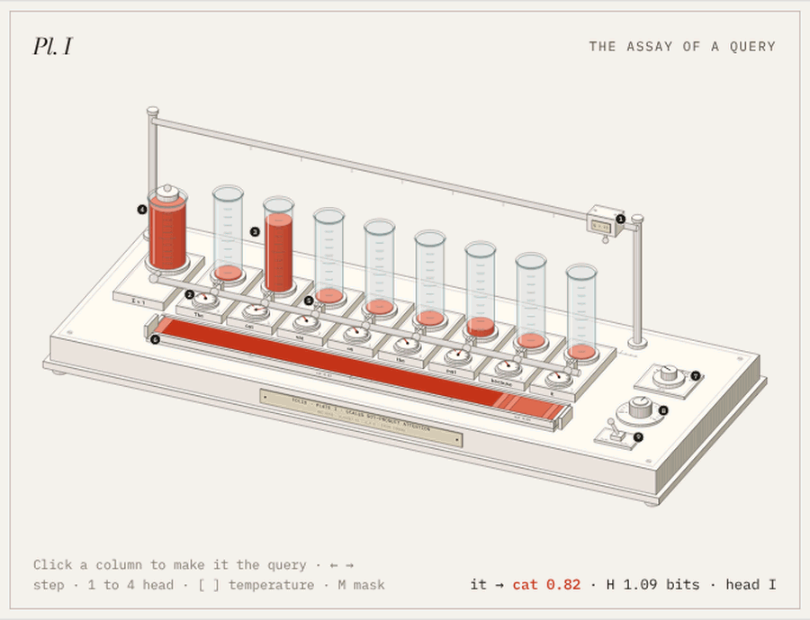
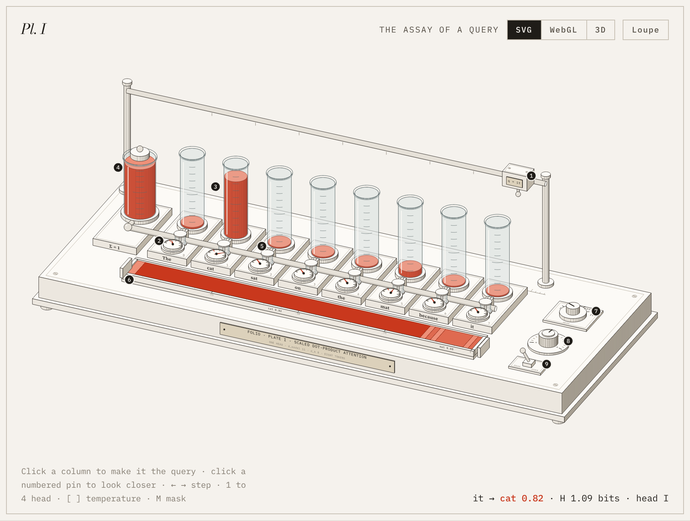
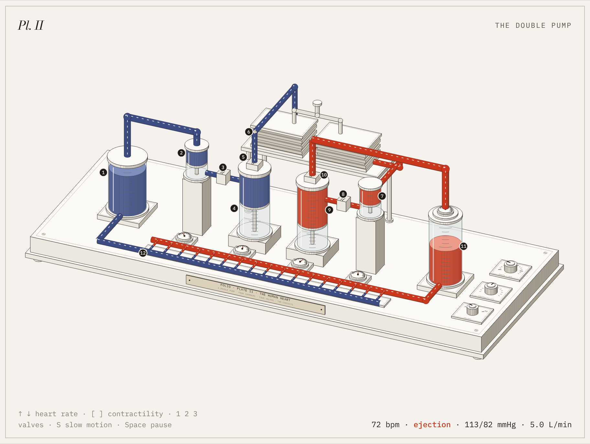
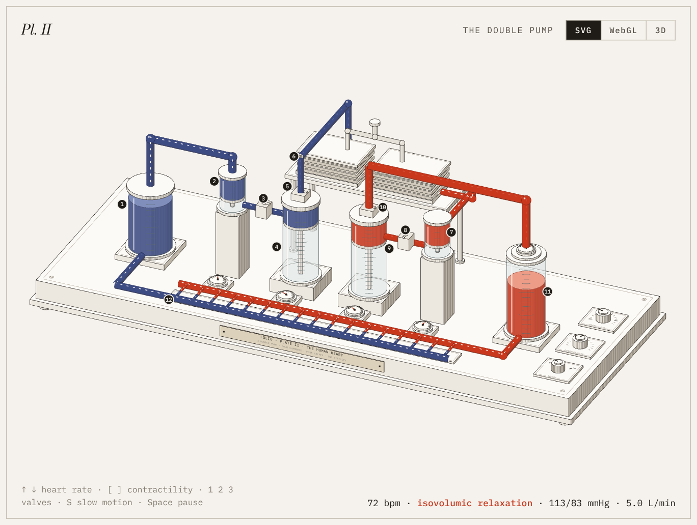
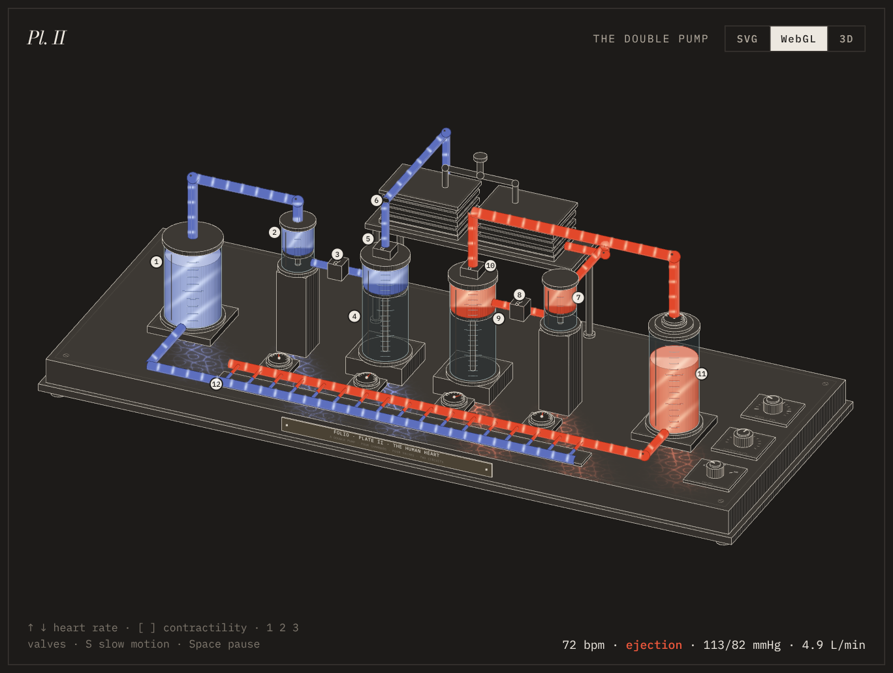
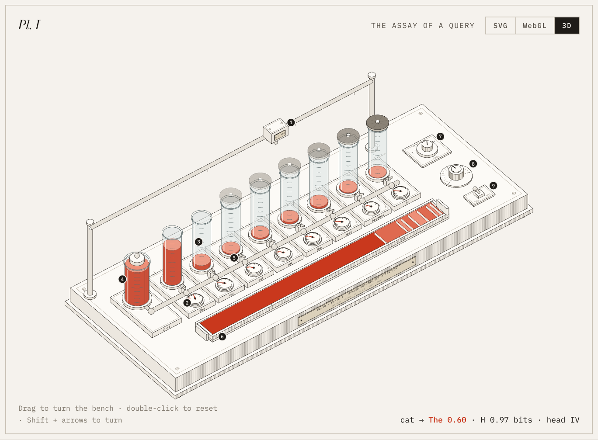
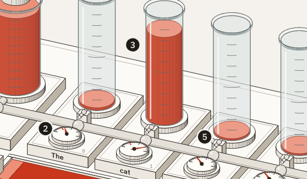
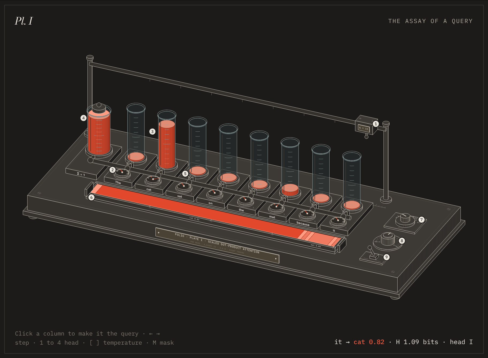

<div align="center">

<sub>A SKILL FOR CLAUDE CODE</sub>

# Folio

*Explain an idea the way a museum explains a specimen.*

[The collection](#the-collection) · [Install](#ii-install) · [Commission a plate](#iii-commission-a-plate) · [Anatomy of a plate](#iv-anatomy-of-a-plate) · [Make your own](#v-make-your-own)

<br>



<sub><i>Plate I. Attention, as an assay bench.</i></sub>

</div>

<br>

## The collection

<table>
<tr>
<td width="50%" valign="top"><a href="docs/attention.html"></a></td>
<td width="50%" valign="top"><a href="docs/heart.html"></a></td>
</tr>
<tr>
<td valign="top"><b>Plate I · Attention, as an assay bench</b><br><sub>Machine learning. A sealed reservoir pours one unit of attention between eight words by softmax. Four heads, a temperature knob and a causal mask.</sub></td>
<td valign="top"><b>Plate II · The heart, as a double pump</b><br><sub>Physiology. Four piston chambers, four valves and two circuits, run by a live model of the circulation. Slow it down, speed it up, or give it a narrowed or leaking valve.</sub></td>
</tr>
</table>

Both plates live on one website, with a cover page written as a short illustrated essay: **[ramakm.github.io/folio-anatomy/docs](https://ramakm.github.io/folio-anatomy/docs/)**. Its source is in [`site/`](site/) and the built site in [`docs/`](docs/) (see [VI](#vi-the-website)).

<br>

## Three views of every plate

Each plate has a switch in its top corner: **SVG · WebGL · 3D**, plus two ways to look closer: press any numbered pin for a zoomed view of that part with its live reading, or turn on the **Loupe** to magnify the bench under your pointer.

<table>
<tr>
<td width="33%" valign="top"></td>
<td width="33%" valign="top"></td>
<td width="33%" valign="top"></td>
</tr>
<tr>
<td valign="top"><b>SVG</b><br><sub>The engraved drawing: solid parts, tones by facing, hatching that follows the shade.</sub></td>
<td valign="top"><b>WebGL</b><br><sub>Light over the drawing. Pulses run along vessels at the true flow, fluid glows with its value, and rippled light falls across the bench. A mask rendered from the drawing keeps the light off anything hidden.</sub></td>
<td valign="top"><b>3D</b><br><sub>Drag to turn the bench. Every part is re-projected, re-shaded and re-ordered from the new angle. Double-click to reset.</sub></td>
</tr>
</table>

<br>

## I. The idea

Most technical diagrams are boxes and arrows. They name the parts but leave the motion to your imagination.

A Folio plate turns the idea into an instrument whose working parts carry it out, then mounts that instrument the way a museum would. You can read it as an engraving, light it with WebGL, or turn it in 3D. Each part gets a numbered pin, a catalogue key says what each pin computes, and four wall texts walk through the math with live numbers.

In Plate I, eight glass columns stand for eight words. A sealed reservoir holds exactly one unit of fluid and shares it between the columns by softmax, so the columns always sum to one because the reservoir never holds more. The shares settle as layers in a tray, and the length of each layer is that word's attention weight.

Every plate keeps three commitments:

| | |
|:--|:--|
| **Mechanism, not metaphor** | The instrument performs the idea. The fluid is the probability mass. |
| **A single source of numbers** | One small model drives the needles, the readout, the key and the tables, so they cannot disagree. |
| **A guided reading** | A numbered key, a term-by-term reading, the full working, and an honest note on what was simplified. |

<br>

## II. Install

```bash
npx skills add Ramakm/folio-anatomy -g -a claude-code
```

This installs Folio for every project, in `~/.claude/skills/folio`. Leave out `-g` to install it only into the current project.

<details>
<summary>Install with git instead</summary>

<br>

```bash
# for you, in every project
git clone https://github.com/Ramakm/folio-anatomy.git ~/.claude/skills/folio

# for one project, shared with everyone who works on it
git clone https://github.com/Ramakm/folio-anatomy.git .claude/skills/folio
```

If the `skills` folder did not exist when your session started, run `/reload-skills`.

</details>

<br>

## III. Commission a plate

Name the idea, not the drawing:

```
/folio explain how a hash map resolves collisions
/folio explain backpropagation through a single neuron, for a course page
/folio how does consistent hashing move keys when a server joins
/folio explain the KV cache in LLM inference, dark theme
/folio design the human heart anatomy
```

Claude works in four phases:

| Phase | What happens |
|:--|:--|
| **Brief** | States the scope and time. Writes the model first and tests it. Proposes an instrument and a correspondence table: *term → part → what you see*. |
| **Bench** | Lays out the parts in depth bands, builds the static geometry once, and draws the moving parts in live slots. Places the numbered pins. |
| **Mount** | Builds the exhibition page: title block, mounted plate, key, controls, and four wall texts. |
| **Proof** | Takes light, dark and phone screenshots plus enlarged crops, then checks every number against the model. |

You don't have to type `/folio`. Any request for an explanatory figure or interactive explainer can pick the skill up.

<br>

## IV. Anatomy of a plate

<table>
<tr>
<td width="50%" valign="top">

**The drawing is engraved.**
Faces are toned by how they face the light, and round parts are hatched more densely toward their shadow side, so they read as turned metal. Warm grey for the instrument, one red for the quantity being explained.

</td>
<td width="50%" valign="top">

**The page is curated.**
Wall text I reads the formula one term at a time, pointing at pins by number. Its live working box updates as you turn the knobs.

</td>
</tr>
<tr>
<td></td>
<td></td>
</tr>
</table>

A finished plate has, top to bottom:

1. **Masthead and title block.** The idea named as its instrument, with a catalogue list: Object, Idea, Model, Catalogue.
2. **The mounted plate.** Corners carry the plate number, the caption, the interaction hint and a live readout.
3. **The key.** One entry per pin. Hovering an entry highlights its pin, and hovering a pin highlights its entry.
4. **At the bench.** Ordinary controls that match the instrument's knobs.
5. **Wall text I, reading the plate.** One column per term of the formula.
6. **Wall text II, the ledger.** The full working, row by row.
7. **Wall text III, the wider view.** The full matrix, sequence or table the plate shows one slice of.
8. **Wall text IV, about this specimen.** What is exact, what was chosen by hand, and what was left out.

<br>

<table>
<tr>
<td width="50%"></td>
<td width="50%"></td>
</tr>
<tr>
<td align="center"><sub>Gallery light</sub></td>
<td align="center"><sub>Gallery dark</sub></td>
</tr>
</table>

Every colour is a CSS custom property, so plates follow the reader's theme. To use your own brand, swap the token block at the top of `page.html`. The structure and the engraving stay the same.

<br>

## V. Make your own

```bash
npm install                                   # Playwright, for the screenshot checks
node scripts/new-plate.mjs kv-cache           # copies Plate I into examples/kv-cache
# rewrite model.js, plate.js, page.html and page.js
node scripts/build.mjs examples/kv-cache dist/kv-cache.html
node scripts/capture.mjs dist/kv-cache.html shots
```

`capture.mjs` saves light, dark and phone screenshots. `--crop x,y,w,h` adds an enlarged crop, and `--eval "Plate.update({ q: 3, head: 1 })"` captures a particular state. It also reports console errors and any sideways scrolling.

<br>

## VI. The website

`node scripts/build-site.mjs` builds every plate and the cover page into `docs/`:

```
docs/index.html        the cover: the collection, install, the method
docs/attention.html    Plate I
docs/heart.html        Plate II
docs/img/              thumbnails and README images
```

To put it online, open the repo on GitHub, go to **Settings → Pages**, and choose **Deploy from a branch → `main` → `/docs`**. The site will then be at `https://ramakm.github.io/folio-anatomy/`.

To add your own plate to the site, add its name to `PLATES` in `scripts/build-site.mjs` and a card to `site/index.html`.

<br>

## VII. In the repository

```
SKILL.md                 the skill: commitments, four phases, plate grammar, style, library
kit/folio-kit.js         the drawing library: camera, engraved boxes and cylinders, glass, pins, text
kit/folio-live.js        the three views: stage, WebGL light layer, orbit, view switch
kit/folio-page.css       the shared exhibition styles: mount, key, wall texts, both themes
examples/attention/      Plate I: model.js, plate.js, page.html, page.js
examples/heart/          Plate II: a lumped-parameter model of the circulation and its bench
site/index.html          the cover page of the website
scripts/build.mjs        inline one plate into a standalone HTML file
scripts/build-site.mjs   build the whole website into docs/
scripts/capture.mjs      screenshots and checks
scripts/new-plate.mjs    start a new plate from Plate I
docs/                    the built website
```

`SKILL.md` also works on its own: the drawing library is included at the end of it as an appendix.

**Requirements.** Claude Code, or any agent that reads Agent Skills. Node.js 20 or later. Playwright with Chromium, only for the screenshot checks. The drawing library has no dependencies.

<br>

## Acknowledgement

Folio was inspired by [Anatomy](https://github.com/wheresryan22/anatomy) by Ryan, which first showed that Claude can draw an idea as a working isometric machine. Folio is an independent project. Its code, drawing library, skill text and plates were all written from scratch, with a different focus: museum-style curation, a numbered key and wall texts, engraved shading, and a written account of what each plate simplifies.

<br>

<div align="center">

<sub>MADE BY</sub>

**Ramakrushna Mohapatra**

[Instagram @techwith.ram](https://www.instagram.com/techwith.ram/) · [X @techwith_ram](https://x.com/techwith_ram)

<sub>MIT License · 2026</sub>

</div>
