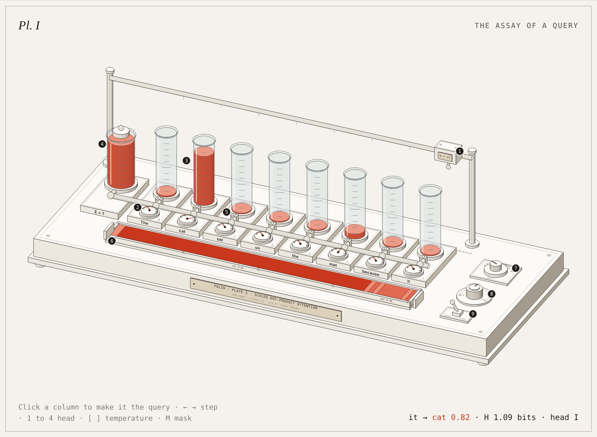

# Folio

**Explain a technical idea the way a museum explains a specimen.**

Folio is a skill for Claude Code. Give it an idea and it designs an instrument whose moving parts carry out that idea. It draws the instrument as a live, engraved isometric figure, then mounts it on an exhibition page: a numbered key, controls, and four wall texts that walk the reader through the math.



*Plate I: attention as an assay bench. Each word has a glass column. A sealed reservoir holds one unit of fluid and shares it out by softmax. The result settles into a tray of layers whose lengths are the attention weights. Open `dist/attention.html` in a browser to use it.*

## Why plates

A diagram tells the reader that parts exist. A plate shows those parts working. Every Folio plate keeps three commitments:

- **Mechanism, not metaphor.** The instrument does the work of the idea. The fluid really is the probability mass, and the reservoir really does hold exactly one unit.
- **A single source of numbers.** One small pure model computes everything, so the needles, readout, key, tables and text always agree.
- **A guided reading.** Each plate has a numbered key, a term-by-term walkthrough with live numbers, the full working, and a note on what was simplified.

## Install

One command, with the [`skills`](https://github.com/vercel-labs/skills) CLI:

```bash
npx skills add Ramakm/folio-anatomy -g -a claude-code
```

`-g` installs it for you in every project (`~/.claude/skills/folio`). Leave out `-g` to install it only into the current project (`.claude/skills/folio`). `-a claude-code` sets it up for Claude Code only. The CLI needs a recent Node.js.

Or clone into your personal skills folder:

```bash
git clone https://github.com/Ramakm/folio-anatomy.git ~/.claude/skills/folio
```

Or into a single project, so everyone working on it gets the skill:

```bash
git clone https://github.com/Ramakm/folio-anatomy.git .claude/skills/folio
```

Claude Code finds `SKILL.md` at the folder root. If the `skills` folder did not exist when your session started, run `/reload-skills`.

`SKILL.md` alone also works: the drawing library is included as an appendix, so a copy of that single file is enough to build plates.

## Use

Ask for an idea, not a drawing:

```
/folio explain how a hash map resolves collisions
/folio explain backpropagation through one neuron, for a course page
/folio how does consistent hashing move keys when a server joins
/folio explain the KV cache in LLM inference, dark theme
```

Claude names the scope first (a quick sketch, a full plate, or a series), writes and tests the model, proposes the instrument and a correspondence table (term → part → what you see), then builds, screenshots and checks the plate.

You don't have to type `/folio`. Any request for an explanatory figure or interactive explainer can pick the skill up.

## Make your own plate by hand

```bash
npm install                       # Playwright, for the screenshot checks
node scripts/new-plate.mjs kv-cache   # copies Plate I into examples/kv-cache
# edit model.js, plate.js, page.html, page.js
node scripts/build.mjs examples/kv-cache dist/kv-cache.html
node scripts/capture.mjs dist/kv-cache.html shots
```

`capture.mjs` saves light, dark and phone screenshots, and an enlarged crop with `--crop x,y,w,h`. It reports console errors and sideways scrolling. Add `--eval "Plate.update({ q: 3, head: 1 })"` to capture a particular state.

## What is in the repo

```
SKILL.md                  the skill: commitments, four phases, plate grammar, style, library reference
kit/folio-kit.js          the drawing library: camera, engraved boxes and cylinders, glass, pins, engraved text
examples/attention/       Plate I
  model.js                the attention head; every number on the page comes from here
  plate.js                the bench: static geometry, live slots, input
  page.html               the mount, styles and wall texts
  page.js                 key, controls, ledger, matrix
scripts/build.mjs         inline everything into one standalone HTML file
scripts/capture.mjs       screenshots and checks (Playwright + Chromium)
scripts/new-plate.mjs     start a new plate from Plate I
dist/attention.html       Plate I, built
docs/                     screenshots for this README
```

## Requirements

- Claude Code (or any agent that reads Agent Skills)
- Node.js 20 or later for the build and scaffold scripts; the library has no dependencies
- Playwright with Chromium, only for `capture.mjs`

## Light and dark

Every colour is a CSS custom property, so plates follow the reader's theme. To use your own brand, swap the token block at the top of `page.html` and keep the structure.


## Inspiration

Folio was inspired by [Anatomy](https://github.com/wheresryan22/anatomy) by Ryan, which first showed that Claude can draw an idea as a working isometric machine. Folio is an independent project. Its code, drawing library, skill text and plates were all written from scratch, with a different focus: museum-style curation, a numbered key and wall texts, engraved shading, and a written account of what each plate simplifies.

## License

MIT © 2026 Ramakrushna Mohapatra · [techwith.ram](https://techwithram.com) · [@techwith_ram](https://x.com/techwith_ram)
