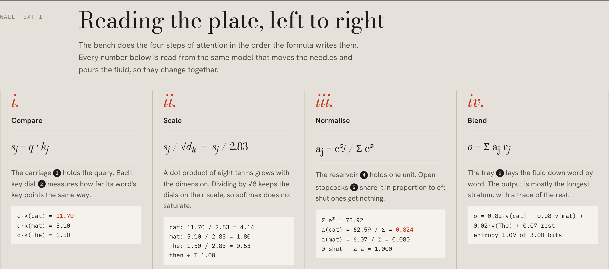

<div align="center">

<sub>A SKILL FOR CLAUDE CODE</sub>

# Folio

*Explain an idea the way a museum explains a specimen.*

[Install](#ii-install) · [Commission a plate](#iii-commission-a-plate) · [Anatomy of a plate](#iv-anatomy-of-a-plate) · [Make your own](#v-make-your-own)

<br>


<sub><i>Plate I. Attention, as an assay bench. Open <code>dist/attention.html</code> to use it.</i></sub>

</div>

<br>

## I. The idea

Most technical diagrams are boxes and arrows. They name the parts but leave the motion to your imagination.

A Folio plate turns the idea into an instrument whose working parts carry it out, then mounts that instrument the way a museum would. Each part gets a numbered pin, a catalogue key says what each pin computes, and four wall texts walk through the math with live numbers.

In Plate I, eight glass columns stand for eight words. A sealed reservoir holds exactly one unit of fluid and shares it between the columns by softmax, so the columns always sum to one because the reservoir never holds more. The shares settle as layers in a tray, and the length of each layer is that word's attention weight.

Every plate keeps three commitments:

| | |
|:--|:--|
| **Mechanism, not metaphor** | The instrument performs the idea. The fluid is the probability mass. |
| **A single source of numbers** | One small model drives the needles, the readout, the key and the tables, so they cannot disagree. |
| **A guided reading** | A numbered key, a term-by-term reading, the full working, and an honest note on what was simplified. |

<br>

## II. Install

```bash
npx skills add Ramakm/folio-anatomy -g -a claude-code
```

This installs Folio for every project, in `~/.claude/skills/folio`. Leave out `-g` to install it only into the current project.

<details>
<summary>Install with git instead</summary>

<br>

```bash
# for you, in every project
git clone https://github.com/Ramakm/folio-anatomy.git ~/.claude/skills/folio

# for one project, shared with everyone who works on it
git clone https://github.com/Ramakm/folio-anatomy.git .claude/skills/folio
```

If the `skills` folder did not exist when your session started, run `/reload-skills`.

</details>

<br>

## III. Commission a plate

Name the idea, not the drawing:

```
/folio explain how a hash map resolves collisions
/folio explain backpropagation through a single neuron, for a course page
/folio how does consistent hashing move keys when a server joins
/folio explain the KV cache in LLM inference, dark theme
```

Claude works in four phases:

| Phase | What happens |
|:--|:--|
| **Brief** | States the scope and time. Writes the model first and tests it. Proposes an instrument and a correspondence table: *term → part → what you see*. |
| **Bench** | Lays out the parts in depth bands, builds the static geometry once, and draws the moving parts in live slots. Places the numbered pins. |
| **Mount** | Builds the exhibition page: title block, mounted plate, key, controls, and four wall texts. |
| **Proof** | Takes light, dark and phone screenshots plus enlarged crops, then checks every number against the model. |

You don't have to type `/folio`. Any request for an explanatory figure or interactive explainer can pick the skill up.

<br>

## IV. Anatomy of a plate

<table>
<tr>
<td width="50%" valign="top">

**The drawing is engraved.**
Faces are toned by how they face the light, and round parts are hatched more densely toward their shadow side, so they read as turned metal. Warm grey for the instrument, one red for the quantity being explained.

</td>
<td width="50%" valign="top">

**The page is curated.**
Wall text I reads the formula one term at a time, pointing at pins by number. Its live working box updates as you turn the knobs.

</td>
</tr>
<tr>
<td></td>
<td></td>
</tr>
</table>

A finished plate has, top to bottom:

1. **Masthead and title block.** The idea named as its instrument, with a catalogue list: Object, Idea, Model, Catalogue.
2. **The mounted plate.** Corners carry the plate number, the caption, the interaction hint and a live readout.
3. **The key.** One entry per pin. Hovering an entry highlights its pin, and hovering a pin highlights its entry.
4. **At the bench.** Ordinary controls that match the instrument's knobs.
5. **Wall text I, reading the plate.** One column per term of the formula.
6. **Wall text II, the ledger.** The full working, row by row.
7. **Wall text III, the wider view.** The full matrix, sequence or table the plate shows one slice of.
8. **Wall text IV, about this specimen.** What is exact, what was chosen by hand, and what was left out.

<br>

<table>
<tr>
<td width="50%"></td>
<td width="50%"></td>
</tr>
<tr>
<td align="center"><sub>Gallery light</sub></td>
<td align="center"><sub>Gallery dark</sub></td>
</tr>
</table>

Every colour is a CSS custom property, so plates follow the reader's theme. To use your own brand, swap the token block at the top of `page.html`. The structure and the engraving stay the same.

<br>

## V. Make your own

```bash
npm install                                   # Playwright, for the screenshot checks
node scripts/new-plate.mjs kv-cache           # copies Plate I into examples/kv-cache
# rewrite model.js, plate.js, page.html and page.js
node scripts/build.mjs examples/kv-cache dist/kv-cache.html
node scripts/capture.mjs dist/kv-cache.html shots
```

`capture.mjs` saves light, dark and phone screenshots. `--crop x,y,w,h` adds an enlarged crop, and `--eval "Plate.update({ q: 3, head: 1 })"` captures a particular state. It also reports console errors and any sideways scrolling.

<br>

## VI. In the repository

```
SKILL.md                 the skill: commitments, four phases, plate grammar, style, library
kit/folio-kit.js         the drawing library: camera, engraved boxes and cylinders, glass, pins, text
examples/attention/      Plate I
  model.js               the attention head; every number on the page comes from here
  plate.js               the bench: static geometry, live slots, input
  page.html              the mount, styles and wall texts
  page.js                key, controls, ledger and matrix
scripts/build.mjs        inline everything into one standalone HTML file
scripts/capture.mjs      screenshots and checks
scripts/new-plate.mjs    start a new plate from Plate I
dist/attention.html      Plate I, built
```

`SKILL.md` also works on its own: the drawing library is included at the end of it as an appendix.

**Requirements.** Claude Code, or any agent that reads Agent Skills. Node.js 20 or later. Playwright with Chromium, only for the screenshot checks. The drawing library has no dependencies.

<br>

## Acknowledgement

Folio was inspired by [Anatomy](https://github.com/wheresryan22/anatomy) by Ryan, which first showed that Claude can draw an idea as a working isometric machine. Folio is an independent project. Its code, drawing library, skill text and plates were all written from scratch, with a different focus: museum-style curation, a numbered key and wall texts, engraved shading, and a written account of what each plate simplifies.

<br>

<div align="center">

<sub>MADE BY</sub>

**Ramakrushna Mohapatra**

[Instagram @techwith.ram](https://www.instagram.com/techwith.ram/) · [X @techwith_ram](https://x.com/techwith_ram)

<sub>MIT License · 2026</sub>

</div>
